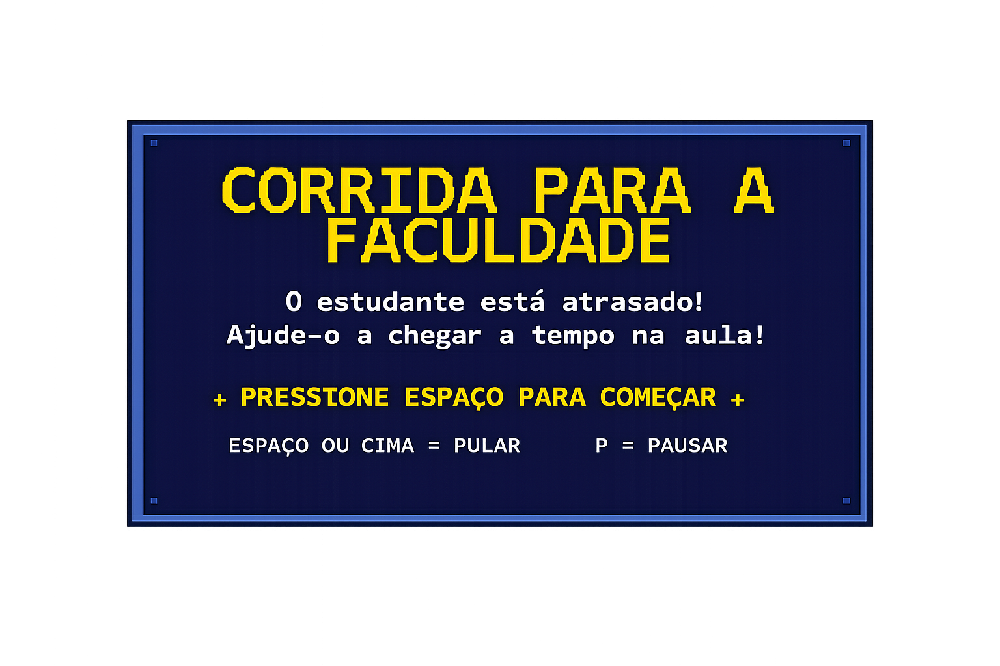
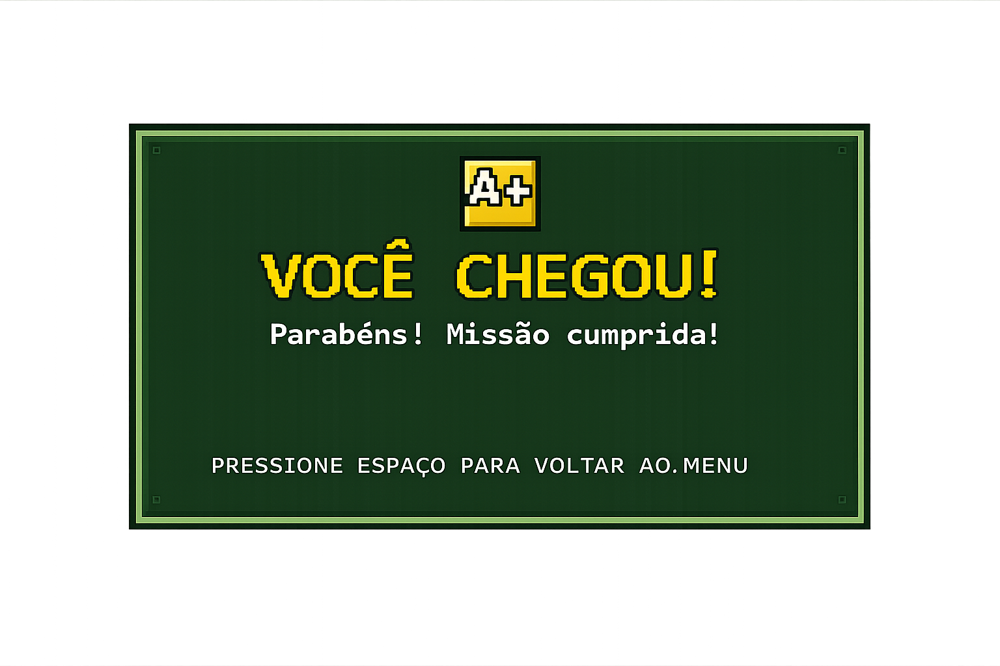
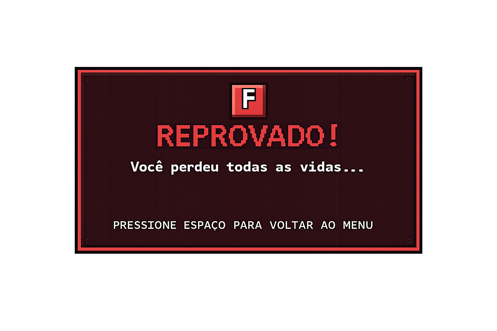

# Corrida para a Faculdade

[English](README.md) · Português

Jogo 2D do tipo endless runner, feito em Python e Pygame. Um estudante está atrasado para
a aula e precisa desviar dos obstáculos da cidade para chegar a tempo. Chegar a 1000
pontos é ser aprovado; perder as 3 vidas é ser reprovado.

Projeto acadêmico com foco em lógica de jogo e programação orientada a estados.

## Telas

| Início | Vitória | Derrota |
|---|---|---|
|  |  |  |

## Funcionalidades

- Máquina de estados clara: menu -> jogo -> fim (vitória ou derrota) -> menu
- Física de pulo com gravidade e força de salto
- Obstáculos aleatórios (cone, lixeira, relógio e trave), com intervalo de aparição que diminui conforme a pontuação aumenta
- Dificuldade progressiva: a velocidade aumenta a cada 100 pontos, até um limite
- 3 vidas, com invencibilidade temporária e efeito de piscar após uma colisão
- HUD com barra de progresso até a meta, pontuação, recorde e vidas
- Recorde salvo em `recorde.txt` (fora do controle de versão)
- Cenário com rolagem contínua, sombras e telas próprias de menu, pausa e fim de jogo
- Plano B: se faltar algum arquivo de imagem, o jogo continua funcionando com formas simples

## Controles

| Tecla | Ação |
|---|---|
| `Espaço` ou `Seta para cima` | Pular |
| `P` | Pausar / continuar |
| `Esc` | Voltar ao menu |

## Tecnologias

- Python 3
- Pygame

## Estrutura

```
.
├── main.py              # jogo completo: estados, física, colisão e renderização
└── imagens/
    ├── background.png   # cenário
    ├── source.png       # sprite do personagem
    └── obstaculos/      # obstáculos + telas da interface (início, pausa, vitória, derrota)
```

## Como executar

```bash
pip install pygame
python main.py
```

O jogo abre em tela cheia (`pygame.FULLSCREEN | pygame.SCALED`). Pressione `Esc` para
voltar ao menu e feche a janela para sair.

## Autoria

Código do jogo desenvolvido por Giovanna Ribas dos Reis - projeto acadêmico individual.

## Transparência

- O código do jogo (`main.py`) é de minha autoria, não foi gerado por IA.
- Os elementos visuais em `imagens/` (cenário, sprite e telas da interface) foram gerados por IA.
